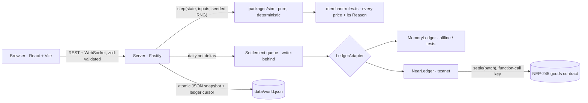

# Saltmarket

**A browser trading game where the economy *is* the game: ten NPC merchants with their own wallets set prices from their own stock and demand, explain every price in plain English, and settle balances as NEP-245 tokens on NEAR — without the player ever seeing the chain.**

Built at NEAR HACKATHON for the **Games With Real Economies** **AI SWARMS** **AGENT ECONOMY** tracks.


| | |
| --- | --- |
| Run it | `pnpm install && pnpm dev` → http://127.0.0.1:5173 (offline, no keys needed) |
| Contract (testnet) | `goods.samuelowen.testnet`, NEP-245 multi-token ([`contracts/goods`](contracts/goods)) |
| First live settlement | tx `3P2frBFCJFAVwQJ1gZKWsdsTXiPf4TwttEjMcmLgqZQf` (batch `72-96`, 0 reconciliation mismatches) |
| Pricing rules, one file | [`packages/sim/src/pricing/merchant-rules.ts`](packages/sim/src/pricing/merchant-rules.ts) |
| Checks (run 2026-11-14) | 65 TypeScript tests · 44 contract unit tests · sim lint · typecheck: all pass |

## The problem

Game economies are usually fake. A designer types prices into a spreadsheet and nothing changes until the next patch. Onchain games fix ownership but tend to put the chain in the player's face: wallets, seed phrases, gas prompts. LLM-driven NPCs can talk, but their decisions are expensive, non-reproducible and hard to audit.

Saltmarket takes a different route:

- **Merchants are rule-based economic agents, not scripted shops.** Each one holds its own marks and goods, decides prices from its stock, recent sales and costs, and is limited by a spending policy. Every decision produces a structured reason plus a one-line explanation, and the tooltip shows that same text.
- **The simulation is deterministic.** Same seed + same inputs = same world, byte for byte (state hash test). Shocks, recovery and stability can be replayed and tested.
- **The chain is the ledger, not the game loop.** Matching and pricing run off-chain at game speed. Ownership and balances settle on NEAR in idempotent batches, so the game never waits for a block and a player never signs anything.

## What you can do

| Track requirement | What is built | Evidence |
| --- | --- | --- |
| Gather materials, trade with NPC merchants | Shared nodes (Pier, Salt pans, Grove) with cooldowns, crowding and regeneration. Sell into merchants' buy offers, buy from their asks, craft barrels, cure fish, sell to the visiting ship | Test `the thin slice works: gather → sell, and buy inputs → cure → sell to the ship` |
| Each merchant is an agent with its own wallet and inventory | 10 NPCs: 3 fishermen, 2 salt-panners, 2 woodcutters, a cooper, a smokehouse, a ship captain ([`roster.ts`](packages/shared/src/config/roster.ts)). Loop per tick: observe → decide → **policy guard** (per-trade and per-day spend caps, cash floor, allowed goods) → act → log | [`npcs/agent.ts`](packages/sim/src/npcs/agent.ts), [`npcs/guard.ts`](packages/sim/src/npcs/guard.ts) |
| Prices from stock and recent demand; flooding makes a good cheap | Ask = cost + margin, pushed up by low stock or fast sales, down by surplus, clamped to 0.5×–2.5× the anchor. Bids work back from the output price and drop in a glut | Flood scenario: **timber median −42% within a day**, woodcutters produce less (10 vs 14), back within 8% in 5 days |
| A broke merchant closes until someone invests | Out of cash → `MERCHANT_CLOSED`. A player invests 150–600 marks → shop reopens, investor is repaid 25% of daily profit, capped at 125%. No investor in 5 game days → the Town Fund rescues it | Closure scenario: closed merchant never trades; payouts never exceed 125%; rescue fires |
| Items are NEP-245 multi tokens, one contract | `marks`, `fish`, `salt`, `timber`, `barrel`, `cured_fish`, `hall_license` are token ids on one contract | [`contracts/goods`](contracts/goods), 44 unit tests + 1 sandbox end-to-end test |
| Social or email login; no seed phrases, pop-ups or gas | Privy email/Google sign-in or guest play. The server signs and pays for every settlement. A test fails if chain words ("wallet", "gas", "mint", "blockchain", …) appear in player-facing UI | `auth.test.ts`, `vocabulary.test.ts` |
| Pricing rules in one readable file, reasoning in a tooltip | Every merchant price and quantity decision is in [`merchant-rules.ts`](packages/sim/src/pricing/merchant-rules.ts) (commented for non-programmers). Its functions return the `Reason` shown in the tooltip, so explanation and rule can't drift apart | `GET /api/npcs/:id/explain` returns the reason, its factors and `rulesFile` |
| Fast-forward: a week in a minute | **Watch a week** steps a deep clone of the town 168 ticks, streamed in ~60 s, with optional storm, flood and closure shocks. The live town is untouched | [`timelapse.ts`](packages/sim/src/timelapse.ts); measured 168 ticks in 60.2 s in the browser |
| Player-owned markets | Buy an **Exchange Hall** license (400 marks), set its fee (0–5%), earn a cut of every trade routed through it. Merchants move to the cheapest venue | Hall scenario: merchants move within 3 days; the 1% Hall out-earns the 4% Hall (11.8 vs 0.0 marks) |
| Economy evolves without a dev patch | Sinks (rent, upkeep, living costs, demurrage, licenses) balance the faucet (the Captain's purchases). Supply responds to price. The Captain adapts his ceiling and order size after each visit | `pnpm sim:tune --seeds 10`: no price stuck at a clamp, burn/mint 0.86–1.16, money supply −4% to +14% over 30 days |
| Game loop designed on paper first | 30 s / 5 min / session loops, approved 2026-11-09 before any code | [`docs/GAME_LOOP.md`](docs/GAME_LOOP.md); test `reflects the approved loop` |

**The Storm (demo centerpiece).** A storm cuts the fish catch by 85%. Nobody scripts the reaction; it comes out of the rules. `pnpm sim:storm --seed 42` checks it:

```
PASS  ticks +1..+6: fishermen give the storm as their reason
PASS  ticks +1..+6: fish asks up ≥ 15% (40%)
PASS  day +1: Smokehouse pauses or buys less fish (0 vs 19)
PASS  day +1..+4: a ship visit goes short and the Captain raises his ceiling (46.1 → 48.7)
PASS  by day +6: fish median within ±20% of baseline (15%)
```

In the UI, fishermen's cards read *"Storm kept the boats in. Stock is low, raising my price 22%."*, the price row shows ▲, and the news feed explains each move.

## How NEAR is used

- **One NEP-245 contract** ([`contracts/goods`](contracts/goods), Rust, near-sdk 5.29.1) holds the currency, all goods and Hall licenses. It implements NEP-245 core (`mt_transfer`, `mt_batch_transfer`, balances, supply), the metadata and enumeration extensions, and a NEP-145 storage subset. Deployed on testnet at `goods.samuelowen.testnet`.
- **Off-chain matching, onchain settlement.** Once per game day (24 ticks ≈ 1 real minute) the server turns net balance changes into ordered mints → transfers → burns and sends them as one `settle(batch)` call. Batches carry a contiguous tick range and are **idempotent by batch id**: a replayed part returns `applied: false` and changes nothing.
- **Restart-safe.** The contract keeps a settlement cursor, and the server persists unconfirmed batches with its world snapshot. After a crash it re-sends in order and never re-mints. It refuses to settle a fresh world onto a contract that already has history.
- **Least-privilege keys.** The server signs with a function-call key scoped to the contract and unable to attach deposits. It can `settle`, `mt_mint`, `mt_burn`, `register_accounts` and `pause`. `unpause`, `propose_authority`, `add_token` and cursor resets need exactly 1 yoctoNEAR, which only a full-access key can attach. A leaked server key can't unpause the contract, rotate the authority, or move NEAR. Authority changes take two steps (propose → accept).
- **Accounts.** Every sim account maps deterministically to an id under the authority (e.g. `fisher-1.samuelowen.testnet`). These are balance entries on the contract, not separately created NEAR accounts.
- **Measured cost.** ~0.0014 NEAR of gas per daily batch on testnet.
- **Invisible to players, visible to judges.** Players see marks and goods only. The judge-only **Ledger** drawer shows batches, status, transaction hashes and in-game vs last-settled balances.

## Try it in 60 seconds

```bash
pnpm install
JUDGE_MODE=1 pnpm dev    # real economy, offline ledger: server :3000, game at http://127.0.0.1:5173/?judge=1
```

| Do | See |
| --- | --- |
| Type a name, press **Play as guest** | Your stall opens with 300 marks; the top bar shows purse, town clock and ship countdown |
| **Gather fish**, then **Sell all** on the Fish row (pick a venue with a buyer) | "+2 fish", then a toast like "Sold 7 fish to Old Pell's Smokehouse for 57.4 marks" |
| Hover, tap or Tab to a merchant's quote or a price | A popover with the reason, its factors (stock, sales, margin, cost) and a link to `merchant-rules.ts` |
| Judge strip → **Storm** | Storm banner; fishermen raise prices and say why; news feed explains each move |
| Judge strip → pick the Cooper → **Force broke**, then **Invest** | "Closed: needs investment" → "You backed Agathe with 150 marks"; the shop reopens |
| **Exchange Halls** → **Buy license**, set a fee | Your Hall in the comparison table with fee, volume and owner income |
| **Watch a week** → keep "Storm on day 2" → **Watch a week** | Seven days in ~60 s: price lines, merchant purses, scrolling reasons, then a summary ending "No patch, no tweaks". Your live purse doesn't change |
| Judge strip → **Ledger** | Settlement batches and reconciliation (mode `memory` offline, `near` on the testnet server) |

Also works at phone width (bottom tabs). Without a browser:

1. `curl -s localhost:3000/healthz` → `{"ok":true,…,"serverMode":"live",…}`
2. `curl -s localhost:3000/api/npcs/fisher-2/explain` → Brina's reason, factors and `"rulesFile":"packages/sim/src/pricing/merchant-rules.ts"`
3. `curl -s -X POST localhost:3000/api/dev/event -H 'content-type: application/json' -d '{"kind":"storm"}'` → `"Storm starts next hour."` (`403 JUDGE_ONLY` without `JUDGE_MODE=1`)

## Verify it yourself

Each script runs the real simulation headless, checks the invariants after every tick, and exits non-zero on failure.

| Do | See |
| --- | --- |
| `pnpm sim:storm --seed 42` | The six Storm checks above, all `PASS` |
| `pnpm sim:week --seed 42 --storm-day 3` | A day-by-day story of a week, ending `invariants: ok (checked every frame)` |
| `pnpm sim:tune --seeds 10` | Four stability checks over 10 seeds × 30 days, all `PASS` |
| `pnpm sim:headless --seed 42 --days 30` | Daily prices, money supply, minted vs burned, Captain ceiling and fill |
| `pnpm test` | 65 tests in 15 files (list below) |
| `pnpm lint` | `lint-rules: ok`: the sim contains no `Math.random`, `Date.now`, `new Date`, `fetch` or `node:` imports |
| `pnpm contracts:test` | 44 contract unit tests + 1 end-to-end scenario on a local NEAR sandbox |
| `pnpm near:check --contract goods.samuelowen.testnet --authority samuelowen.testnet` | Live contract status, settlement cursor and storage (read-only, signs nothing) |

What the 65 tests cover: mark and good conservation over 30 days and several seeds; determinism by state hash; Storm across seeds; flood; Hall competition; closure, investment and rescue; settlement that is idempotent, ordered, split into parts and correct across restarts; net deltas → ops reproducing target balances in 200 random windows; a NearLedger run against a contract model; Privy token checks (issuer, audience, signature, expiry); the mock and live servers passing one shared protocol conformance suite; design tokens and motion budgets; no chain words in player UI.

Tuning history, one lever at a time: [`docs/TUNING_LOG.md`](docs/TUNING_LOG.md).

## Architecture



| Layer | Path | Notes |
| --- | --- | --- |
| Shared protocol + config | [`packages/shared`](packages/shared) | zod schemas for every WS/REST message (v0.2.0, additive only); all tunable numbers in one [`economy.ts`](packages/shared/src/config/economy.ts); money as integer pips (1 mark = 100) |
| Simulation | [`packages/sim`](packages/sim) | No clock, no I/O; seeded mulberry32 RNG kept in world state, so snapshots and clones replay exactly |
| Chain adapter | [`packages/chain`](packages/chain) | `LedgerAdapter` interface; `MemoryLedger` and `NearLedger` (near-api-js 7.4.0) are interchangeable; errors classified as retryable or needs-a-human |
| Server | [`apps/server`](apps/server) | Tick loop, per-connection rate limit, judge routes gated by `JUDGE_MODE`, atomic snapshots (temp file + rename), daily reconciliation against the contract |
| Web | [`apps/web`](apps/web) | Keyboard-operable controls; ▲/▼ alongside color; `prefers-reduced-motion` respected; layout down to 390 px |
| Contract | [`contracts/goods`](contracts/goods) | NEP-245 + settlement + roles; see its [README](contracts/goods/README.md) |

### Engineering decisions worth a look

- **Explanations come from the decision itself.** Each pricing function returns `{ price, reason }`, and the tooltip prints that `reason`. There is no second copy of the logic to fall out of sync.
- **Conservation is checked, not assumed.** Total marks must always equal genesis + minted − burned, counting buy-order escrow. Goods are checked the same way, per good. The checks run after every tick in tests and in every headless script ([`invariants.ts`](packages/sim/src/invariants.ts)).
- **Testnet limits shaped the contract.** On live testnet the binding limit for a batch is 16 KiB of logs per receipt, not gas. So the contract groups NEP-245 events, and `NearLedger` splits large windows into ordered parts (mints first, burns last), retrying a part that is still too large ([`docs/NEAR_INTEGRATION.md`](docs/NEAR_INTEGRATION.md)).
- **The game degrades instead of stopping.** If the RPC is down, play continues on the queue. A fatal contract error stops settlement and shows it in the Ledger drawer as "stuck at <batch>"; it is not retried forever. A rate-limited reconciliation is logged and skipped (both tested).
- **The fast-forward is a sandbox.** Watch a week runs on a `structuredClone` of the world, so judges can trigger shocks without touching the live economy.

More: [`docs/ARCHITECTURE.md`](docs/ARCHITECTURE.md), [`docs/ECONOMY.md`](docs/ECONOMY.md), [`docs/NPC_AGENTS.md`](docs/NPC_AGENTS.md), [`docs/NEAR_INTEGRATION.md`](docs/NEAR_INTEGRATION.md).

## Tracks

- `games`: every row of the requirement table above, plus the Storm.
<!-- team lead decides whether to add agents/swarms (docs/PROJECT_OVERVIEW.md §6); list only what is demonstrable -->

## Limitations

- **Custodial.** The server operates all ledger accounts and can move any balance via `settle`. Privy identifies the player; its embedded wallet is not used for game assets.
- **NPC wallets are contract balance entries,** not separately created NEAR accounts, and have no per-NPC keys. Spending limits are enforced by the simulation's policy guard, not onchain.
- **Matching is off-chain;** the chain receives one net settlement per game day.
- **Testnet only.** Nothing runs on mainnet. NEAR Intents is not used.
- **Bot players vs. sinks.** With five always-on bot players gathering for free, money supply grows faster than sinks remove it. The NPC-only economy passes every stability check.
- **The Captain's storm reaction is seed-dependent.** A short visit followed by a higher ceiling depends on where the storm falls in his 2-day schedule: it happens on the demo seed (42) and in 2 of 10 seeds.
- **Social login:** server-side token verification is tested. The full browser sign-in with a real inbox and the Ledger drawer in `near` mode are checked manually, not in automated tests.

## Run locally

Requires Node ≥ 22 and pnpm 11. Copy `.env.example` to `.env` (it lists names only; never commit values).

| Mode | Command | Needs |
| --- | --- | --- |
| Offline (default) | `pnpm dev` | nothing (`LEDGER=memory`) |
| Judge controls | `JUDGE_MODE=1 pnpm dev`, open `?judge=1` | nothing |
| Mock data for UI work | `pnpm dev:mock` | nothing |
| Testnet settlement | `pnpm dev:chain` | `NEAR_RPC_URL`, `NEAR_CONTRACT_ID`, `NEAR_AUTHORITY_ID`, `NEAR_AUTHORITY_KEY_FILE` (function-call key file) |
| Social login | set `PRIVY_APP_ID` and `PRIVY_VERIFICATION_KEY` (or `PRIVY_APP_SECRET`) | a Privy app |
| Demo world | `pnpm demo:seed` | writes `data/world.json` with two labeled demo Halls |

Ports: `PORT=3100 pnpm dev` moves the server and points the web app at it; `WEB_PORT` moves the web app.

## License and credits

<!-- license: team decides (docs/SUBMISSION.md §6) -->
